# RetroBit Agent

Aplikasi Android native (Kotlin + Jetpack Compose) untuk membangun aplikasi web kecil langsung dari HP: minta lewat chat, AI menulis file, lalu lihat hasilnya di preview. Terinspirasi alur kerja [rork.com](https://rork.com), tetapi berjalan **sepenuhnya di perangkat** — tanpa server perantara.

<p align="left">
  
  
  
  
</p>

<p align="center">
  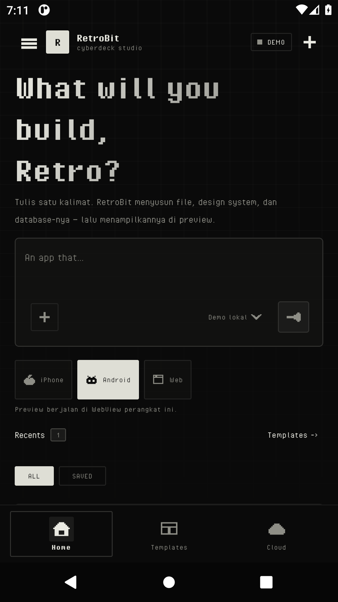
  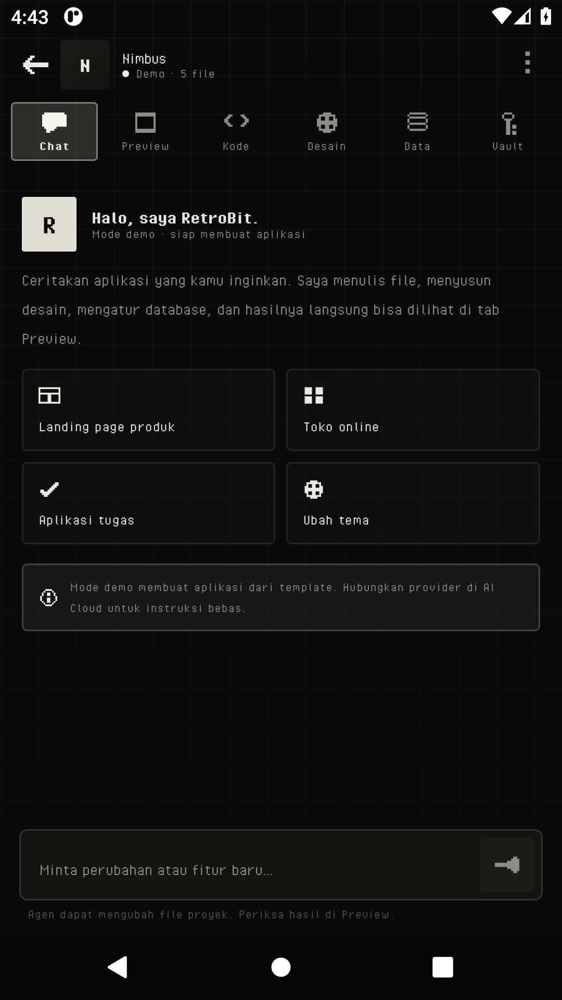
  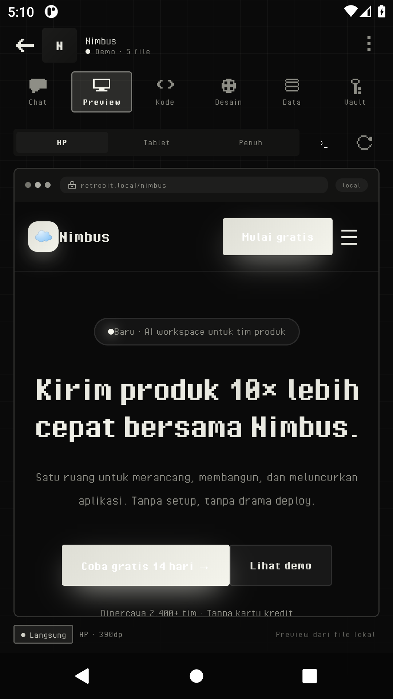
  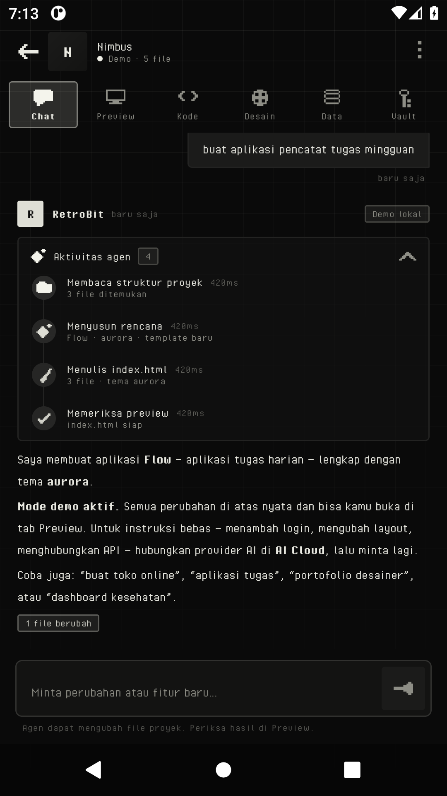
  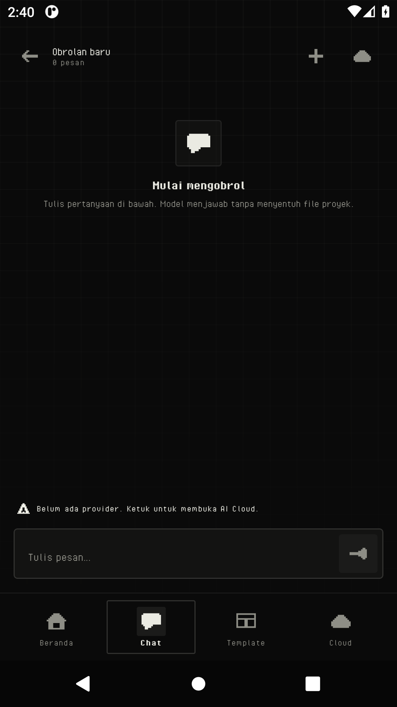
  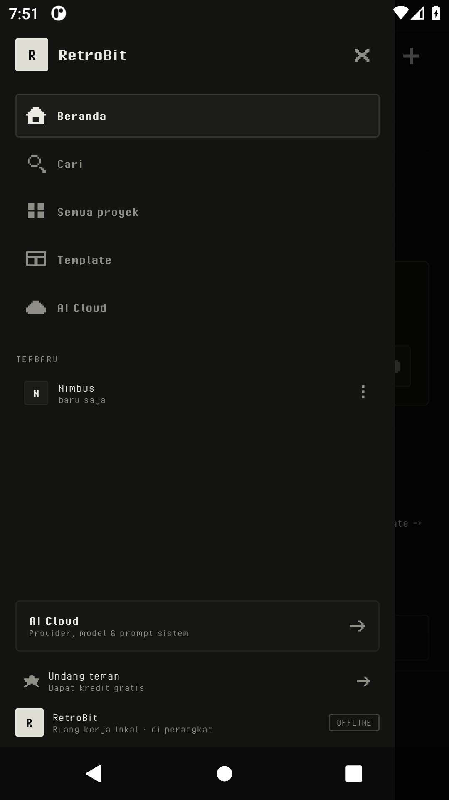
  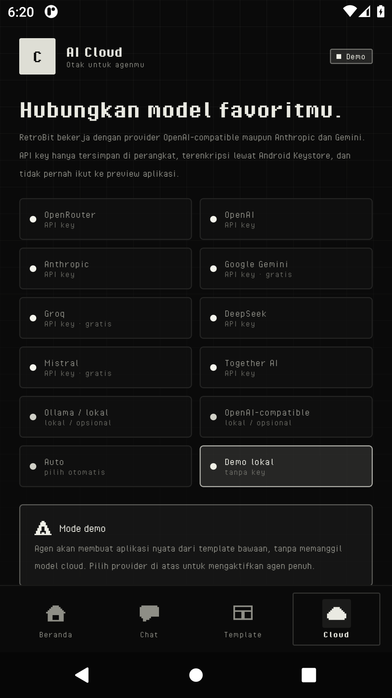
  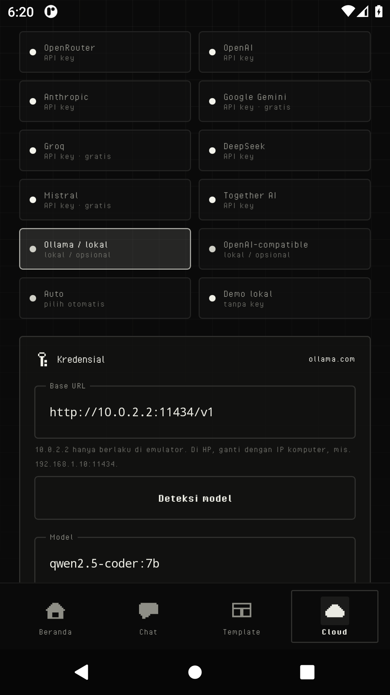
  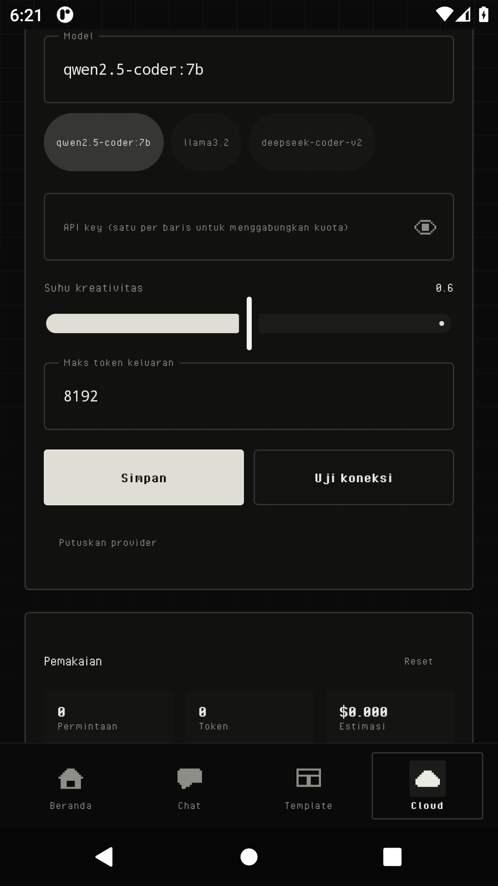
</p>

<p align="left">
  <a href="https://github.com/retrobit-dev/RetroBit-Agent/actions/workflows/android.yml"></a>
</p>

## Fitur

| Area | Yang bisa dilakukan |
| --- | --- |
| **Preview aplikasi** | WebView lokal dengan chrome HP/tablet/desktop, reload otomatis saat file berubah, console log, dan preview LAN untuk dibuka dari browser lain di jaringan yang sama. |
| **Design** | Design system monokrom bergaya e-paper: token warna, radius, dan font. Preset bawaan (midnight, aurora, sunset, candy, mono, terminal, paper) dan editor token manual. Perubahan langsung diterapkan ke preview tanpa reload. |
| **AI Cloud** | Hubungkan OpenRouter, OpenAI, Anthropic, Gemini, Groq, DeepSeek, Mistral, Together AI, Ollama lokal, atau endpoint OpenAI-compatible sendiri. Ada uji koneksi, pemilih model, estimasi pemakaian token/biaya, dan **system prompt global** untuk semua chat baru. |
| **Secret** | Vault terenkripsi (AES-GCM + Android Keystore) untuk API key. Secret hanya masuk ke preview bila kamu centang "expose", dan AI hanya tahu **nama** secret — bukan nilainya. |
| **Database** | SQLite per proyek: buat tabel, tambah kolom, isi data contoh, jalankan query, lihat hasil. Kode di preview bisa mengaksesnya lewat `window.RetroBitDB`. |
| **Dashboard** | Beranda bergaya rork/cyberdeck: drawer dengan recents, hero "What will you build, Retro?", composer satu baris, pemilih target iPhone/Android/Web, dan filter All/Saved. Tema monokrom e-paper dengan font Pixel Operator dan set ikon piksel 12×12 buatan sendiri. |
| **Chat / Agent** | Agen dengan 11 tool (baca/tulis/edit/hapus file, rename, update design, tabel & SQL, minta secret). Setiap perintah AI otomatis membuat snapshot yang bisa dipulihkan. |
| **Template** | 7 starter: SaaS (Nimbus), tugas (Flow), toko online (Lumen), kesehatan (Pulse), chat (Relay), portofolio (Atelier), dan kanvas kosong. |
| **Ekspor** | Bagikan proyek sebagai ZIP lewat FileProvider (file `_meta` tidak ikut). |

Mode **Demo** aktif secara default sehingga seluruh aplikasi bisa dicoba tanpa API key: agen demo memilih template, tema, dan data contoh dari kata kunci permintaanmu.

## Persyaratan

- Android Studio **Ladybug (2024.2.1)** atau lebih baru — Kotlin 2.0 dan AGP 8.7.
- JDK 17 (JDK bawaan Android Studio sudah cukup).
- Android SDK Platform 35 + Build-Tools 35.
- Perangkat/emulator **Android 8.0 (API 26)** ke atas.
- Gradle 8.9 (langsung diunduh oleh wrapper — `gradlew`, `gradlew.bat`, dan `gradle/wrapper/gradle-wrapper.jar` sudah disertakan).

## Menjalankan

1. Buka folder root proyek ini di Android Studio (`File → Open`).
2. Tunggu Gradle Sync selesai. Jika diminta mengatur SDK, arahkan ke Android SDK Platform 35.
3. Jalankan konfigurasi `app` pada emulator atau perangkat fisik.

Atau lewat terminal:

```bash
./gradlew assembleDebug        # APK di app/build/outputs/apk/debug/
./gradlew installDebug         # pasang ke perangkat yang terhubung
```

> Build pertama membutuhkan internet untuk mengunduh Gradle dan dependensi Maven.

## Unduh & pasang APK

Rilis resmi: **<https://github.com/retrobit-dev/RetroBit-Agent/releases>**

1. Unduh `app-release.apk` dari rilis terbaru.
2. Buka file itu di HP (Files → Downloads → ketuk APK), izinkan **Install unknown apps** untuk aplikasi Files/browser.
3. Atau lewat komputer: `adb install -r app-release.apk`.

APK rilis ditandatangani (v1 + v2) dengan kunci demo di `signing/`, jadi versi berikutnya bisa dipasang sebagai *update*.

> **Kunci demo itu publik.** Siapa pun bisa membuat APK yang Android terima sebagai update aplikasi ini. Untuk distribusi serius, jalankan `bash scripts/rotate-keystore.sh`, unggah empat secret yang dicetaknya (`Settings → Secrets and variables → Actions`), lalu hapus `signing/retrobit-release.p12` dari repo. CI sudah membaca keempat secret itu dan menampilkan sidik jari sertifikat di log, jadi pergantian kunci bisa dipastikan tanpa membuka APK. Langkah lengkapnya di [`signing/README.md`](signing/README.md).

Build rilis melewati **R8 + resource shrinking**: dari 7,7 MB (v0.2.6) menjadi **1,9 MB** (v0.2.7). Smoke test di emulator memasang APK rilis hasil minify — bukan build debug — jadi kalau ada aturan keep yang kurang, CI yang gagal, bukan pengguna.

> **Penting kalau kamu pernah memasang build lama (≤ v0.1.0):** build itu memakai kunci debug Android, berbeda dengan kunci rilis sekarang. Uninstall dulu aplikasinya sekali (`adb uninstall dev.retrobit.agent` atau tekan lama ikon → Uninstall), baru pasang `app-release.apk`. Setelah itu update berikutnya cukup ditimpa.

## Build di GitHub Actions

Repo ini punya workflow `.github/workflows/android.yml` yang membangun APK debug di runner Ubuntu GitHub — tidak perlu memasang JDK/Android SDK di komputer.

- Jalan otomatis pada setiap `push` ke `main` / `arena/**`, setiap pull request, dan bisa dipicu manual dari tab **Actions → Android CI → Run workflow**.
- Hasil build diunggah sebagai artifact **`retrobit-debug-apk`** (30 hari).
- Mendorong tag `v*` juga menerbitkan GitHub Release berisi `app-release.apk` dan `app-debug.apk`:

```bash
git tag -a v0.1.0 -m "RetroBit 0.1.0"
git push origin v0.1.0
```

Rilis terbaru: <https://github.com/retrobit-dev/RetroBit-Agent/releases>. Unduh `app-release.apk`, lalu pasang lewat `adb install -r app-release.apk` atau buka file-nya di HP (izinkan "install unknown apps"). `app-debug.apk` disediakan untuk investigasi (tidak di-minify, 11 MB).

Workflow memakai JDK 17 (Temurin), Gradle wrapper 8.9, `gradle/actions/setup-gradle` untuk cache, dan SDK Platform 35 yang sudah tersedia di runner. Kalau kompilasi gagal, error Kotlin dicatat sebagai *check annotation* sehingga langsung terlihat di ringkasan run tanpa perlu membuka log.

## Alur pertama kali

1. Aplikasi membuka tab **Proyek** dan otomatis membuat proyek contoh **Nimbus** dari template SaaS.
2. Ketuk proyek → masuk **Workspace** dengan enam tab: Chat, Preview, Kode, Design, Data, Vault.
3. Di tab Chat, minta sesuatu — misalnya *"buat aplikasi kebiasaan dengan grafik mingguan"*.
4. Tab **Preview** menampilkan hasilnya; tab **Design** untuk mengubah tema; tab **Vault** untuk mengisi secret.
5. Untuk memakai model sungguhan, buka **AI Cloud** → pilih provider → tempel API key → **Uji koneksi** → **Simpan**.

## Menghubungkan AI

| Provider | Base URL default | Contoh model |
| --- | --- | --- |
| Auto | — | memilih dari key yang tersimpan |
| Demo lokal | — | `retrobit-demo` (tanpa key) |
| OpenRouter | `https://openrouter.ai/api/v1` | `anthropic/claude-sonnet-4.5`, `qwen/qwen3-coder` |
| OpenAI | `https://api.openai.com/v1` | `gpt-4.1`, `gpt-4.1-mini` |
| Anthropic | `https://api.anthropic.com` | `claude-sonnet-4-5` |
| Google Gemini | `https://generativelanguage.googleapis.com` | `gemini-2.5-flash` |
| Groq | `https://api.groq.com/openai/v1` | `llama-3.3-70b-versatile` |
| DeepSeek | `https://api.deepseek.com/v1` | `deepseek-chat` |
| Mistral | `https://api.mistral.ai/v1` | `mistral-large-latest` |
| Together AI | `https://api.together.xyz/v1` | `Qwen/Qwen3-Coder-480B-A35B-Instruct` |
| Ollama / lokal | `http://10.0.2.2:11434/v1` | `qwen2.5-coder:7b` |
| OpenAI-compatible | URL sendiri | nama model sendiri |

- Key disimpan di `SharedPreferences` terenkripsi; tidak pernah ditulis ke file proyek atau log.
- Ollama dari emulator memakai `10.0.2.2`; dari perangkat fisik gunakan IP komputer (`http://192.168.x.x:11434/v1`). Cleartext HTTP diizinkan untuk kasus lokal ini.
- Model reasoning OpenAI (`o3`, `o4`, `gpt-5…`) otomatis memakai `max_completion_tokens` dan tanpa `temperature`.

### Model gratis

Tidak ada API gratis tanpa syarat: setiap provider memberi kuota sendiri, dengan batas harian yang bisa berubah. Yang tersedia lewat aplikasi ini:

| Provider | Cara | Batas khas |
| --- | --- | --- |
| Google Gemini | key dari AI Studio, model `gemini-2.5-flash` | ± 10–15 permintaan/menit, ± 250–1.500/hari |
| Groq | key gratis, `openai/gpt-oss-120b` | ± 30/menit, 1.000/hari (per model) |
| OpenRouter | model berakhiran `:free`, atau router `openrouter/free` | 20/menit, 50/hari (1.000/hari setelah pernah top-up $10) |
| Mistral | `mistral-small-latest` | plan eksperimen gratis |
| Ollama / LM Studio | server sendiri | tanpa batas, butuh komputer yang menyala |

Model bertanda `:free` otomatis dihitung **$0** pada estimasi biaya dan diberi badge **GRATIS** di AI Cloud. Provider yang punya kuota gratis (Gemini, Groq, Mistral, Ollama) juga ditandai `API key · gratis`.

Batas di atas adalah angka publik per 2026-10 dan bisa berubah; angka final selalu ada di konsol masing-masing provider.

### Tanpa batas

Layanan berlangganan seperti Arena bisa terasa tanpa batas karena **mereka yang membayar token-nya** — itu keputusan harga, bukan sihir teknis. RetroBit memakai key milikmu, jadi tidak ada cara membuat model frontier gratis tanpa akhir. Yang bisa dilakukan, dan sudah dikerjakan:

1. **Beberapa key per provider.** Tempel satu key per baris di kolom API key. Tiga key Groq berarti 3.000 permintaan/hari, bukan 1.000. Key yang kena `429`/`401` disingkirkan sementara (5 menit untuk rate limit, 24 jam untuk key ditolak) dan key berikutnya langsung dipakai.
2. **Auto melewati provider yang habis.** Kuota harian dicatat per provider (`Gemini 200`, `Groq 1.000`, `OpenRouter 50` per key). Begitu anggaran habis, Auto tidak mengirim request yang pasti gagal — ia pindah ke provider berikutnya.
3. **Model lokal benar-benar tanpa batas.** Ollama atau LM Studio di komputer sendiri tidak punya kuota per hari: tidak ada biaya per token, hanya listrik. Kualitasnya di bawah model frontier, tapi untuk obrolan dan kode sederhana cukup — dan tidak akan pernah menagih atau menolak karena kuota.

### Menyiapkan model lokal

Di komputer (sekali saja):

```bash
OLLAMA_HOST=0.0.0.0 ollama serve        # dengarkan di jaringan, bukan cuma localhost
ollama pull qwen2.5-coder:7b            # model yang muat di RAM kamu
```

Di HP, sambungkan ke Wi-Fi yang sama, lalu di **AI Cloud → Ollama / lokal**:

1. Isi Base URL dengan IP komputer, mis. `192.168.1.10:11434` — skema `http://` dan akhiran `/v1` ditambahkan otomatis.
2. Tekan **Deteksi model** — aplikasi membaca `GET /api/tags` dan menampilkan model yang benar-benar terpasang. Tidak perlu menebak nama.
3. Pilih model, lalu **Simpan**.

`10.0.2.2` hanya berlaku di emulator (itu cara emulator memanggil komputer host); di HP alamat itu tidak menuju ke mana-mana, dan aplikasi memberi tahu saat mendeteksinya. Kalau koneksi ditolak, biasanya firewall komputer memblokir port 11434.


Angka kuota itu salinan konservatif dari batas publik, dipakai untuk mengarahkan Auto, bukan untuk menagih. Kalau butuh model teratas tanpa memikirkan kuota, langganan berbayar tetap satu-satunya jalan — dan kamu bisa memakai key itu di sini.

### Streaming

Jawaban chat muncul kata per kata. Ketiga dialek provider didukung: OpenAI-compatible (`data:` + `delta.content`), Anthropic (`content_block_delta`), dan Gemini (`streamGenerateContent?alt=sse`). Kalau sebuah endpoint menolak `stream`, klien tetap punya jalur non-streaming dan permintaan akan gagal dengan pesan provider — bukan jawaban kosong.

Repaint dibatasi ~60 ms supaya markdown tidak diurai ulang puluhan kali per detik. Agen pembangun aplikasi sengaja masih non-streaming: tool call harus utuh sebelum dieksekusi, jadi potongan teks di tengah putaran hanya akan menyesatkan.

### Mode Chat

Tab **Chat** di bilah bawah (atau drawer) adalah obrolan biasa:

- tidak memakai tool, tidak membuka proyek, tidak menulis file — satu permintaan, satu jawaban;
- riwayat disimpan terpisah di `filesDir/chat_space.json`, bukan di `projects.json`, jadi menghapus obrolan tidak bisa merusak aplikasi yang sudah kamu buat;
- setiap obrolan menyimpan salinan system prompt saat dibuat; default-nya persona global dari AI Cloud;
- memakai provider yang sedang aktif, termasuk **Auto** dan model `:free`;
- jawaban panjang dibatasi 4.096 token dan hanya 20 giliran terakhir yang dikirim ulang ke model.

Di mode Demo, chat menjawab dengan penjelasan bahwa demo hanya menyusun aplikasi dari template — bukan jawaban palsu.

### Provider Auto

Mode **Auto** mencoba provider yang key-nya sudah tersimpan, dari yang punya kuota gratis lebih dulu:

`Gemini → Groq → OpenRouter (openrouter/free) → Mistral → Together → DeepSeek → Anthropic → OpenAI → Ollama`

Auto berhenti di provider pertama yang benar-benar menjawab. Provider baru dianggap gagal kalau ia tidak menulis file dan tidak mengembalikan teks — jadi pekerjaan setengah jadi tidak diulang di provider lain. Setiap provider dengan beberapa key menghasilkan beberapa percobaan, tetapi sesi agen (yang mahal) paling banyak mencoba dua key per provider; obrolan memakai semuanya. Ollama hanya ikut kalau kolom key-nya diisi (boleh teks apa saja), supaya Auto tidak menunggu server lokal yang mati. Tanpa satu pun key, Auto memberi pesan yang menyuruh mengisi key atau memakai mode Demo.

Auto **bukan** seperti model picker di layanan berlangganan: RetroBit tidak punya server yang membayari inference, jadi Auto memilih dari key milikmu, bukan dari model yang dibayar aplikasi.

## Design system

Token disimpan di `DesignSystem` dan ditulis sebagai CSS variable:

```css
@font-face{
  font-family:'Pixel Operator';
  src:url('assets/fonts/PixelOperator.ttf') format('truetype');
}
:root{
  --rb-primary:#DEDED5; --rb-accent:#F4F4EC; --rb-bg:#0A0A0A;
  --rb-surface:#141413; --rb-text:#EAEAE2; --rb-muted:#8E8E86;
  --rb-radius:4px;      --rb-font:'Pixel Operator', ui-monospace, monospace;
}
```

Palet sengaja **grayscale** — semua warna di luar ramp abu-abu otomatis disnap ke monokrom saat proyek lama dimuat. Font Pixel Operator (CC0) disalin ke setiap proyek di `assets/fonts/` sehingga preview WebView dan ekspor ZIP memakai tipografi yang sama.

Template menyimpan blok ini di antara `/*RB_DESIGN_START*/` dan `/*RB_DESIGN_END*/`. Saat design diubah, RetroBit menulis ulang blok tersebut **dan** menyuntikkan stylesheet langsung ke WebView, jadi preview berubah seketika tanpa reload. Halaman baru cukup memakai `var(--rb-primary)` dan seterusnya agar ikut bertema.

### Ikon

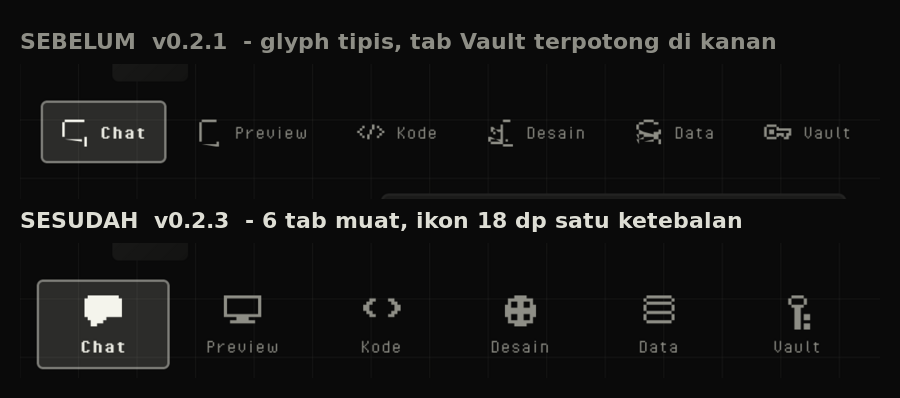

Semua ikon digambar di grid 12×12 lalu ditulis sebagai `ImageVector` 24×24 oleh `tools/pixel_icons.py`. Satu ketebalan garis, tanpa aset pihak ketiga. Lembar kontak di bawah dirender langsung dari generator agar bentuk tiap glyph bisa diperiksa di ukuran 96/48/24/16 px sebelum masuk aplikasi.

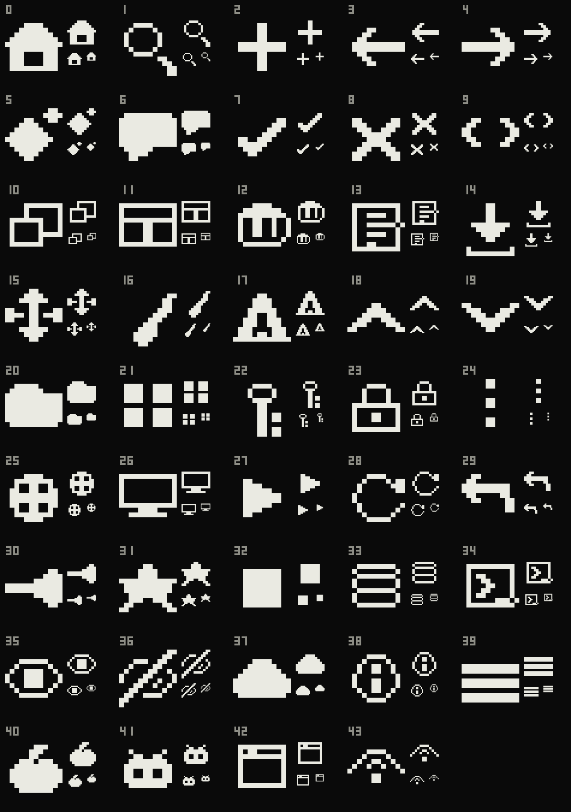

Regenerasi: `python3 tools/pixel_icons.py render` (lembar kontak) dan `python3 tools/pixel_icons.py kotlin` (menulis ulang `PixelIcons.kt`).

## System prompt global

`SettingsStore.DEFAULT_SYSTEM_PROMPT` berisi persona default yang dipakai untuk **setiap chat baru**. Saat proyek dibuat, isi prompt disalin ke `Project.systemPrompt`; mengubah pengaturan global tidak menimpa percakapan yang sudah berjalan. Prompt per chat bisa diubah dari menu workspace (**System prompt obrolan**) atau dikembalikan ke default global dengan **Ikuti global**. Teks persona dikirim sebagai bagian pertama system prompt agen, diikuti aturan produk dan protokol kerja.

## Runtime preview

`PreviewInjector` menambahkan API berikut ke setiap halaman:

```html
<script>
  // Query read-only maupun write ke SQLite proyek
  const tasks = await RetroBitDB.query("SELECT * FROM tasks ORDER BY id DESC");
  await RetroBitDB.exec("INSERT INTO tasks(title,status) VALUES (?,?)", ["Belajar", "active"]);

  // Secret yang sengaja di-expose (Map nama → nilai)
  const env = RetroBitDB.env();
  console.log(env.SUPABASE_URL);

  // Toast bergaya aplikasi
  RetroBitToast("Tersimpan!");
</script>
```

- `RetroBitDB.query(sql, params)` mengembalikan `{ columns, rows, error, message, changes }`.
- `RetroBitDB.env()` sama dengan `window.__RETROBIT_ENV__`.
- Runtime hanya aktif di preview dalam aplikasi; ekspor ZIP tetap HTML biasa.

## Struktur proyek

```
app/src/main/java/dev/retrobit/agent/
├── MainActivity.kt            # edge-to-edge + setContent
├── RetroBitApp.kt             # Application + AppContainer (DI manual)
├── data/
│   ├── Models.kt              # Project, DesignSystem, ChatMessage, QueryResult, ...
│   ├── ProjectFiles.kt        # VFS proyek, snapshot, ekspor ZIP
│   ├── ProjectRepository.kt   # index projects.json + chat thread
│   ├── Templates.kt           # 7 template + penulisan blok design
│   ├── DatabaseManager.kt     # SQLite per proyek + bridge JSON
│   ├── SecretStore.kt         # AES-GCM + Android Keystore
│   └── SettingsStore.kt       # AI config, tema, bahasa, usage
├── ai/                        # AiConfig, AiClient (OpenAI/Anthropic/Gemini)
├── agent/                     # AgentEngine, tool runner, DemoAgent
├── preview/                   # PreviewView (WebView), PreviewInjector, LanPreviewServer
└── ui/
    ├── RetroBitRoot.kt        # NavHost + drawer dashboard + bottom bar
    ├── DrawerController.kt    # CompositionLocal pembuka drawer
    ├── icons/PixelIcons.kt    # 44 ikon piksel 12x12 (24x24 ImageVector)
    ├── theme/, components/    # tema e-paper, markdown, komponen bersama
    └── screens/               # Projects (dashboard), Templates, Cloud, Workspace + 6 pane
app/src/main/assets/templates/ # saas, tasks, commerce, fitness, chat, portfolio, blank
app/src/main/assets/fonts/     # PixelOperator.ttf + PixelOperator-Bold.ttf
app/src/main/assets/licenses/  # NOTICE.txt (CC0 font)
tools/pixel_icons.py           # generator ikon: grid 12x12 -> ImageVector + contact sheet
app/src/main/res/font/         # salinan font agar bisa dipakai Compose
```

Pengujian:

```
./gradlew testDebugUnitTest   # 182 unit test (113 JVM + 69 Robolectric)
./gradlew lintDebug          # Android lint
```

Penyimpanan di perangkat:

```
filesDir/
├── projects.json              # metadata semua proyek
└── projects/<id>/
    ├── index.html             # entry point (dilindungi)
    ├── …file lain
    └── _meta/
        ├── chat.json          # riwayat percakapan (200 pesan terakhir)
        └── snapshots/*.zip    # 10 snapshot terakhir, sebelum tiap perintah AI
```

## Keamanan & privasi

- **Secret terenkripsi** dengan kunci yang dibuat di Android Keystore (tidak dapat diekspor). Jika keystore di-reset, secret lama tidak bisa dibaca — isi ulang dari Vault.
- **Secret tidak ikut ekspor ZIP.** Hanya metadata nama secret yang dibaca agen; nilai tidak pernah dikirim ke model.
- **Ekspos ke preview bersifat opt-in** per secret.
- **LAN server bersifat read-only**, hanya menyajikan file proyek, menolak path `..`, dan tidak menyertakan secret atau database.
- **Cleartext HTTP** diaktifkan agar Ollama/LAN bisa dipakai; untuk produksi, batasi atau matikan `usesCleartextTraffic`.
- Semua data proyek berada di penyimpanan internal aplikasi.

## Lisensi aset

- **Pixel Operator** — Jayvee Enaguas (HarvettFox96), CC0 1.0. Dipakai untuk seluruh UI Compose dan aplikasi yang dibuat.
- **Ikon RetroBit** — digambar sendiri di grid 12×12, ditulis sebagai `ImageVector` oleh `tools/pixel_icons.py`. Tidak ada aset ikon pihak ketiga yang tersisa.
- Detail lengkap ada di `app/src/main/assets/licenses/NOTICE.txt`.

## Aksesibilitas

- Semua tombol di dashboard punya area sentuh **48 dp** walaupun tampilannya lebih kecil; ikon dan labelnya digabung jadi satu node semantik, jadi TalkBack membacanya sebagai "Template", "Demo lokal", atau "Kirim" — bukan tombol tanpa nama.
- Smoke test mengukur ini di emulator: `scripts/ui-walk.sh` membaca pohon semantik dan mencatat `event=touch-targets ... small=N` untuk setiap node yang clickable namun di bawah 48 dp.

## Bahasa antarmuka

Seluruh teks yang tampil di aplikasi berada di `app/src/main/res/values/strings.xml`: navigasi bawah (Beranda, Template, Cloud), drawer (Cari, Semua proyek, AI Cloud), dashboard (Terbaru, Semua, Disimpan, "Aplikasi yang…"), sampai footer Cloud. Tidak ada lagi label Inggris yang ditulis langsung di kode Compose, jadi menambah bahasa lain cukup dengan membuat `values-xx/strings.xml` baru.

## Batasan yang diketahui

- Belum ada streaming token: jawaban muncul setelah satu putaran selesai (dengan indikator langkah berjalan).
- Belum ada sistem plugin/ekstensi; tool agen didefinisikan di `AgentToolRunner`.
- Snapshot hanya memulihkan file sumber, bukan database atau design metadata.
- Preview LAN menyajikan file statis tanpa runtime `RetroBitDB`/`__RETROBIT_ENV__`.
- R8 menghapus kode yang tidak terpakai, jadi stack trace build rilis memakai nama kelas yang diobfuskasi. `mapping.txt` untuk membacanya diunggah sebagai artifact **`retrobit-mapping`** di setiap build CI.
- Unit test mencakup enam area: token design (`DesignSystemTest`), katalog provider/error AI (`AiConfigTest`), filesystem proyek (`ProjectFilesTest`: traversal, zip-slip, snapshot), dan database per proyek (`DatabaseManagerTest`, berjalan di Robolectric dengan SQLite sungguhan: skema, insert/select, parameter terikat, preset seed, jembatan JSON preview, serta `clearAll`), penyimpanan pengaturan dan vault (`SettingsStoreTest`, `SecretStoreTest`: default, persistensi, fallback saat JSON rusak, nilai tidak pernah tersimpan sebagai teks biasa), serta repositori proyek (`ProjectRepositoryTest`: seed pertama, buat/hapus/duplikat, urutan recency, thread chat, ketahanan setelah restart). Mesin obrolan diuji ujung ke ujung lewat MockWebServer (`PlainChatEngineTest`: penolakan mode demo, obrolan kosong, Auto tanpa key, delta streaming, akuntansi pemakaian, batas `max_tokens`, key ditolak, prioritas persona). Format wire tiap provider diuji lewat MockWebServer (`AiStreamingTest`), dan kebijakan kuota/rotasi key diuji tanpa perangkat (`UnlimitedTest`). Alur UI tetap diverifikasi lewat smoke test emulator.

## Troubleshooting

| Gejala | Solusi |
| --- | --- |
| `SDK location not found` | Buat `local.properties` berisi `sdk.dir=/path/ke/Android/Sdk`, atau atur lewat SDK Manager Android Studio. |
| Gradle sync gagal mengunduh | Periksa koneksi; `gradle-wrapper.properties` menunjuk ke `services.gradle.org`. |
| Preview kosong | Pastikan proyek punya `index.html`; buka menu ⋮ → **Muat ulang preview**, lihat **Console**. |
| Preview LAN tidak bisa dibuka | Pastikan HP dan komputer di Wi-Fi yang sama, port default 8787 tidak dipakai aplikasi lain, dan firewall mengizinkan koneksi masuk. |
| 401/403 dari provider | Key salah/kedaluwarsa; buka **AI Cloud** dan uji ulang koneksi. |
| Ollama gagal | Gunakan `10.0.2.2` untuk emulator, `http://IP-LAN:11434/v1` untuk perangkat fisik, dan pastikan `OLLAMA_HOST=0.0.0.0` bila perlu. |

## Teknologi

AGP 8.7.3 · Kotlin 2.0.21 · Compose BOM 2024.12.01 · Navigation Compose 2.8.5 · OkHttp 4.12.0 · kotlinx-serialization 1.7.3 · Coroutines 1.9.0 · Material 3 · WebView · SQLite (SQLiteOpenHelper) · Android Keystore.

---

Dibuat untuk eksperimen membangun aplikasi dari mana saja, langsung dari Android.
